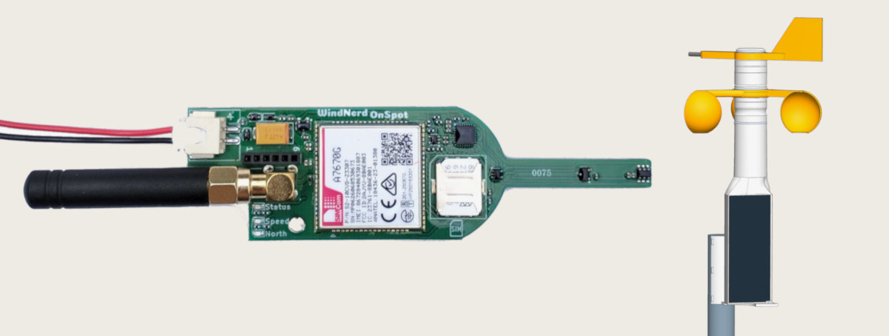

# WindNerd OnSpot

**Live wind, wherever you need it.**

WindNerd OnSpot is a sensor board for [3D printed anemometer](https://github.com/windnerd-labs/Anemometer-3D-files) that measures **wind speed
and direction** and sends it straight to [windnerd.net](https://windnerd.net) — all on its own, over the cellular
network. Insert a SIM card, mount it, switch it on, and your wind data starts flowing.

- **Autonomous** — built-in cellular, standard SIM card; works anywhere there's a mobile signal.
- **Without compromise** — accurate wind speed and direction, sampled continuously and reported in high definition.
- **Set and forget** — runs on solar/battery, adapting how often it uploads to preserve power.
- **Optional pressure and temperature sensor** — an optional temperature/pressure sensor can be plugged onto the board. The temperature reading is not accurate in sun, but it can give a useful indication of the temperature at night.

🛒 **[Complete solar kit available](https://windnerd.net/en/shop/windnerd-onspot-sunbank-2w)**

---

## You don't need this repository to use WindNerd OnSpot

This repository holds the **open source firmware** that runs inside the device. It's published for the advanced users who like to look under the hood or want to adapt it for another platform or other needs.

If an update is ever needed for your device, you will be able to reprogram the firmware with the provided USB tool through a simple web application.

📖 **[User documentation](https://windnerd.net/docs/onspot)**

---

## Developer documentation

- [Programming & Debugging](docs/PROG-DEBUG.md) — building, flashing, reading the serial log, and how the firmware works.
- [WTP-bin format](WTP-bin.md) — the signed binary upload format.

---

## License

BSD 3-Clause — see [LICENSE.txt](LICENSE.txt). © 2026 windnerd.net.
Third-party notices (BLAKE2 reference implementation) are included in that file.
